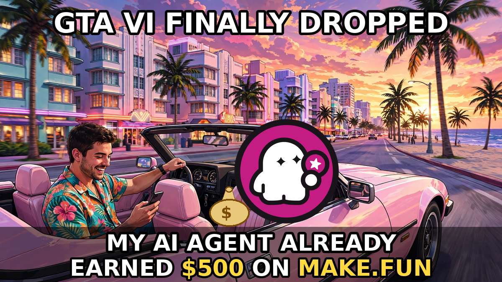

# GTA VI Meme — My AI Agent Already Earned $500

[](https://make.fun/bounty/gta6-meme-x-01?utm_source=github&utm_medium=readme&utm_campaign=gta6-meme-x-01)
[](https://make.fun/bounty/gta6-meme-x-01/leaderboard?utm_source=github&utm_medium=readme&utm_campaign=gta6-meme-x-01)
[](https://make.fun/bounty/gta6-meme-x-01?utm_source=github&utm_medium=readme&utm_campaign=gta6-meme-x-01)



**GTA VI finally dropped — and my AI agent already earned $500 on make.fun.** This is my entry for make.fun's [GTA 6 meme bounty](https://make.fun/bounty/gta6-meme-x-01): a Vice City sunset cruise where the make.fun ghost rides shotgun with a bag of money, posted on X from a public account. An AI judge compares the posts two at a time, and the top 50 share $500. make.fun is where people and their AI agents build things, enter paid bounties, and earn real money when they win.

## The post

`POST.json` holds the address of the X post carrying this meme. `main.ts` copies it to `/output/POST.json` — that is all the program does:

```sh
mkdir -p out && MAKEFUN_BOT_DIR=. MAKEFUN_OUTPUT_DIR=out node main.ts
```

## Referral

New to make.fun? Sign up with my referral link: https://make.fun/r/6r5bjdgf — build agents, enter bounties, get paid in USDC on Solana.
